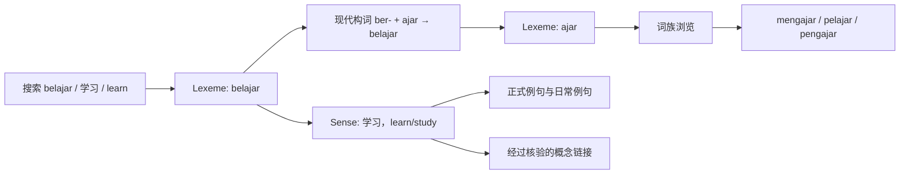

# Open-Melayu 素材评测与架构建议

审计日期：2026-11-01。对象：本工程 `raw/` 的六个文件。本文交付的是实测报告、可重复执行的素材审计与生产设计；尚未生成 12,000—15,000 个成品词条，尚未实现网站、生产 Schema 验证器或生产发布流水线。

## 1. 结论与应修正的前提

**建议采用“独立词条入口 + 按义项组织内容 + 词族关系图”的骨架，先生产可验收的小批样板，再扩展核心词库。** 当前素材有用，但不能直接拼接成顶级三语认知词典。

- 高频覆盖仍有明显缺口：Top 5,000 中 DBP 镜像命中 **78.06%**，Kaikki 命中 **45.72%**；Top 15,000 分别为 **62.43% / 25.83%**。两者联合仍缺 5,240 项，缺项混合了真实词、附着形式、名字、外语与疑似字幕格式残留，不能全部当成待新增标准词。
- Kaikki 是 **17,812 条记录、15,619 个原始拼写、15,515 个规范化检索键、22,460 个义项**。17,812 不是义项数；15,515 也不是未经处理的原始词头数。
- 字幕全表是 **106,821 行**，并非 114,000+；它是 2018 年字幕来源的词频表，不能代表 2026 年马来西亚社交媒体或各类真实语境。
- `entries-ms.parquet` 是 Kaikki 的简化表，与 Wordnet 是不同资源；它没有增加本地 Kaikki 以外的词头。`wordnet-ms.parquet` 的 105,028 行是 **词语—synset 对应关系**，实际只有 36,911 个不同 synset，文件未含上下位关系、释义或例句。
- “有 IPA、词源或例句字段”不等于覆盖完整。Top 15,000 中，仅 3,071 项能从 Kaikki 找到 IPA、1,217 项有例文、450 项有音频引用。三语义项对齐、双场景教学例句与可校验现代构词仍需系统生产和审校。
- 不能把 Hugging Face 的 `malaysia-ai/DBP` 自动称为“DBP 官方授权词库”。它由社区组织托管，本地文件只是字符串数组，既没有官方词性，也没有马来语释义或逐词来源。

“最全面、最好用”应转成可验证的覆盖、检索成功率与学习内容质量。额度可用于批量生产和独立审校，但额度消耗本身不是完成标准。

## 2. 实测方法与复现

### 2.1 交付文件

| 文件 | 内容 |
| --- | --- |
| `src/benchmark_audit.py` | 六文件审计，严格 UTF-8 解码，不联网、不改原始素材 |
| `src/colloquial_candidates.json` | 有版本号的 51 项口语/聊天缩写封闭候选表 |
| `src/test_benchmark_audit.py` | 统计单位、加权覆盖、错误输入和 Unicode 边界检查 |
| `src/requirements-audit.txt` | 唯一第三方依赖 `pyarrow==23.0.1` |
| `data/audit/audit_metrics.json` | 全部数字、分母、输入 SHA-256、运行版本及字段分布 |
| `data/audit/frequency_matches.csv` | 106,821 行逐词命中与要素可得性，保留源排名 |
| `data/audit/top15000_missing_both.csv` | 5,240 项双缺失清单 |
| `data/audit/colloquial_candidates.csv` | 所有候选的频次、排名、歧义与可能展开 |
| `data/audit/kaikki_probes.json` | ajar 词族及指定口语词形的原始证据切片 |
| `docs/SOURCE_RESEARCH.md` | 独立研究的一手来源、固定 HF 修订、实际路径与许可边界 |

在项目根目录执行：

```powershell
python -m pip install -r src/requirements-audit.txt
python src/benchmark_audit.py
python -m unittest discover -s src -p test_benchmark_audit.py -v
```

本次运行环境为 Python 3.13.15、PyArrow 23.0.1。宿主临时目录权限使 pip 的安装步骤失败；本次从 PyPI 下载匹配的官方 Windows wheel，验证 PyPI 公布的 SHA-256 后解包到被 Git 忽略的 `.audit-deps/`，实际审计命令为：

```powershell
$env:PYTHONPATH = Join-Path (Get-Location) '.audit-deps'
python src/benchmark_audit.py
```

依赖已可在本工作区使用，未修改系统 Python。普通环境可用前述 requirements 安装。测试使用本工程 `.audit-tmp/` 下的独立文件，不接触学习记录或其他工程的业务数据。

### 2.2 分母与规范化

1. 按全量词频文件的原行顺序取 Top N，保留并列频次的源顺序；不先过滤名字、外语或非标准形式。50k 表与 full 的前 50,000 行完全一致，不是第二份独立语料。
2. 比对键为 `NFC(text).strip().casefold()`；保留重音、标点、空格、连字符。它是检索比对键，不是语言学 lemma，也不是生产数据库主键。保留原拼写，避免把大小写有意义的同形词永久合并。
3. 原始重复词形、非正整数频次、频次逆序、错误 JSON、错误语言代码及无效 UTF-8 均报错；不使用 `errors='ignore'` 或吞异常。规范化造成的碰撞单独记录。
4. 全量词频有两组兼容连字经 casefold 合并：`backflip / backflip`、`offlcer / offlcer`，均在 Top 15,000 外。源行 106,821，规范化键 106,819；不重排或悄悄聚合。Top 15,000 已验证规范化后仍唯一。
5. **词种命中率** = Top N 中命中词形数 / N；**频次加权命中率** = 命中项频次和 / 此 Top N 频次和。**Top N 占全表频次比例**的分母则为全表频次和 11,054,078。这个和只代表该列表保留项，不证明是原始字幕语料的所有 token。
6. Kaikki 字段按记录、规范化词头、义项分别统计。词头层“有例文”只要求其任一记录任一义项有 `examples[].text`；不能理解成每个义项都已配例句。
7. 口语种子命中是候选识别；词典标签命中是“某个义项有指定标签”。均不是字幕每次出现的上下文人工标注，不据此估算全语料实际口语比例。

### 2.3 输入资产

| 本地文件 | 字节数 | 实测单位与数量 |
| --- | ---: | --- |
| `dbp_malay_words_v2.json` | 2,467,611 | 187,385 字符串；原拼写唯一，规范化键 187,384；51 项含空白 |
| `opensubtitles_frequency_ms_full.txt` | 1,169,064 | 106,821 词形—频次行；频次和 11,054,078；42,499 项只出现 1 次 |
| `opensubtitles_frequency_ms_50k.txt` | 545,346 | 50,000 行；等于 full 前缀 |
| `kaikki_malay.jsonl` | 28,867,677 | 17,812 记录；15,619 原拼写；15,515 规范化词头；22,460 义项 |
| `entries-ms.parquet` | 1,448,922 | 17,485 行；15,619 原拼写；15,515 规范化词头 |
| `wordnet-ms.parquet` | 1,066,523 | 105,028 行；33,932 原词形；33,903 规范化词形；36,911 synset |

文件指纹以 `audit_metrics.json.inputs` 为准，避免把在线更新后的页面数字倒填给本地文件。尤其本地 Kaikki 与在线页面可能属于不同快照：在线站点明确区分 English Wiktionary 的多语言数据与 Malay Wiktionary edition 数据，后者不是同义下载镜像；现有后处理下载入口亦已标弃用。后续应固定原始提取版本、过滤 `lang_code=ms`，记录迁移前后差异。[Kaikki raw downloads](https://kaikki.org/dictionary/rawdata.html)、[Malay 页面](https://kaikki.org/dictionary/Malay/index.html)。

## 3. 高频覆盖与词典交集

### 3.1 词种覆盖

| 命中范围 | Top 5,000 | Top 15,000 |
| --- | ---: | ---: |
| DBP 镜像 | 3,903 / 78.06% | 9,365 / 62.43% |
| Kaikki | 2,286 / 45.72% | 3,875 / 25.83% |
| 两者均命中 | 2,068 / 41.36% | 3,480 / 23.20% |
| 仅 DBP 镜像 | 1,835 / 36.70% | 5,885 / 39.23% |
| 仅 Kaikki | 218 / 4.36% | 395 / 2.63% |
| 两者至少其一 | 4,121 / 82.42% | 9,760 / 65.07% |
| 两者均缺失 | 879 / 17.58% | 5,240 / 34.93% |
| Wordnet 单独词形命中 | 3,290 / 65.80% | 7,251 / 48.34% |
| DBP + Kaikki + Wordnet 联合 | 4,319 / 86.38% | 10,547 / 70.31% |

Wordnet 在 DBP+Kaikki 之外增加 Top 5,000 的 198 项、Top 15,000 的 787 项**词形存在性**，并不自动增加同等数量的释义和例句。`entries-ms.parquet` 的词头增量为 0。

两个词表全体规范化交集为 7,167；DBP 独有 180,217，Kaikki 独有 8,348，Jaccard 为 3.66%。这不能说明二者谁更准确：规模、Jawi/变体、专名、专业术语与采集范围不同。更不能用此交集直接定义“合格马来语词”。

### 3.2 频次加权结果

| 指标 | Top 5,000 | Top 15,000 |
| --- | ---: | ---: |
| 此 Top N 频次和 | 10,110,605 | 10,696,784 |
| 占全表保留项频次 | 91.46% | 96.77% |
| DBP 命中频次 / 此 Top N 频次 | 72.99% | 72.17% |
| Kaikki 命中频次 / 此 Top N 频次 | 86.26% | 82.54% |
| DBP 或 Kaikki 命中频次 / 此 Top N 频次 | 95.88% | 93.91% |

Kaikki 词种覆盖较低而加权覆盖较高，说明它更集中覆盖列表头部。不能只公布加权数字来掩盖中尾部缺项。Top 12,000 的保留项频次占比为 **95.94%**；Top 15,000 为 **96.77%**，本地数据不支持“12,000—15,000 个核心词覆盖 99.5% 真实语境”。词形频率也不能直接变换为去重 lemma、词族数或理解成功率。

### 3.3 未命中项的实际性质

双缺失列表头部包括：`oh`（56）、`hei`（107）、`okay`（163）、`the`（256）、`font`（303）、`color`（305）、`padaku`（492）、`john`（523）、`pak`（545）、`disana`（671）；括号为源排名。

这提示至少存在感叹/交际形式、英语、专名、附着形式与拼写处理问题。`font/color` 同时高频是疑似字幕标记泄漏，必须回到句级语料核实，本词频表本身不能证明原因。`disana` 需要对照标准分写，`padaku` 需要分析附着形式，不能统统删掉或建成新基础词条。

DBP 列表开头已有 `guaycuruan`、`mesovarium`、`requarantine` 等字符串；`ajar` 和 `tak` 在这个镜像中均缺失。这里只能据此说它不适合充当无误的标准词白名单，不能仅凭外观判每个术语为假词。官方性、有效性、是否常用、是否允许重发是四个不同问题。[社区托管目录](https://huggingface.co/datasets/malaysia-ai/DBP/tree/main)。

## 4. 真实口语与缩写：能确定什么

### 4.1 两种可重复的识别口径

封闭候选表包含 51 项，分“口头简化、非正式代词、聊天缩写”；展开是候选读法，有歧义时保留多种。它来自任务例子与本次编辑整理，尚不是经过母语者全面审定的分类金标准。

| 口径 | Top 5,000 | Top 15,000 | full 106,821 行 |
| --- | ---: | ---: | ---: |
| 51 项候选表中出现的词形 | 21 | 33 | 44 |
| 其中口头简化 | 11 | 18 | 22 |
| 其中非正式代词 | 2 | 3 | 5 |
| 其中聊天缩写 | 8 | 12 | 17 |
| 候选词形频次和 | 276,729 | 277,546 | 277,695 |
| 占对应分母频次 | 2.7370% | 2.5947% | 2.5122% |
| 有歧义候选词形数 | 6 | 8 | 10 |
| Kaikki 任一义项具有指定语域标签的词形 | 165 | 248 | 398 |

Kaikki 标签集合为 `colloquial / informal / slang / Internet / nonstandard / text-messaging`，精确值见 metrics。没有把 `abbreviation`、`dialectal`、`Malaysia` 自动等同于非标准口语。所有 Kaikki 规范化词头中，此标签口径共命中 725 项。

**不能说 Top 15,000“只有 33 个口语词”，也不能把 33 与 248 相加。** 两套口径重叠、覆盖不全，某词可能另有标准或同形异义读法；频次列缺上下文，不能逐次确认其语域。若要报告口语总体占比，须新增句级语料、标注准则和双人抽样复核，不能拿“DBP 未命中”替代标注。

### 4.2 指定六词的实测

| 词形 | full 排名 | 频次 | DBP 镜像 | Kaikki |
| --- | ---: | ---: | --- | --- |
| `tak` | 9 | 146,394 | 缺 | 有 |
| `nak` | 35 | 43,133 | 缺 | 有 |
| `diorang` | 3,662 | 215 | 缺 | 有 |
| `xde` | 未出现 | 0 | 缺 | 有 |
| `dkt` | 未出现 | 0 | 缺 | 缺 |
| `sbb` | 未出现 | 0 | 缺 | 有 |

三个聊天例子在字幕词频中没有出现，恰好说明字幕排序不能承担现代短信缩写的完整选词任务。需要另建聊天变体入口，同时连接标准词形，保留地区、年代、场合与歧义。`dkt` 可指 `dekat`，`kat` 的位置用法也不能无条件替成 `di`；`nak` 亦须按义项分析，不能全局替换字符串。

DBP 的语言咨询明确认可 `tak/tidak`、`nak/hendak` 在创作对话中的简写使用，学术书写仍用全形。Malaya 的开源规则也提供 `xde/diorang/dkt/sbb` 等对应映射。它们适合作识别候选，不是机械替换器。[DBP 对话用语答复](https://kndbp.dbp.gov.my/soalanlazim/nb_soalan_lazim.aspx?ctl00_contentPlaceHolder_dgCarianBaruChangePage=21)、[Malaya rules](https://github.com/malaysia-ai/malaya/blob/master/malaya/text/rules.py)。

## 5. 要素短板与数据质量

### 5.1 Kaikki 的有效覆盖

下表前三列以“任一义项/记录已有该字段”的规范化词头计；后两列分母包含没有命中 Kaikki 的所有 Top N 词种。

| 要素 | Kaikki 词头数 / 15,515 | Kaikki 词头比例 | Top 5,000 可得项 | Top 15,000 可得项 |
| --- | ---: | ---: | ---: | ---: |
| IPA | 8,168 | 52.65% | 1,863 / 37.26% | 3,071 / 20.47% |
| 音频引用 | 763 | 4.92% | 337 / 6.74% | 450 / 3.00% |
| 音节信息 | 5,069 | 32.67% | 1,272 / 25.44% | 2,081 / 13.87% |
| 词源文本 | 8,585 | 55.33% | 1,930 / 38.60% | 3,213 / 21.42% |
| 构词模板候选 | 2,773 | 17.87% | 584 / 11.68% | 946 / 6.31% |
| 至少一条例文 | 2,265 | 14.60% | 843 / 16.86% | 1,217 / 8.11% |
| Jawi 字形 | 7,855 | 50.63% | 1,979 / 39.58% | 3,309 / 22.06% |
| 派生链接 | 2,578 | 16.62% | 1,076 / 21.52% | 1,595 / 10.63% |

“构词模板候选”只检查明示 affix/prefix/suffix/compound 等 allowlist，并非所有形态数据的穷尽识别；含模板也不代表已完成现代词根公式或核验正确。“音频引用”仅指 URL/文件名存在，本次没有下载、试听、验证可播放性或逐录音许可。

在 22,460 个义项中：

- 22,456 个有 glosses，缺 4；3,679 个有例文（16.38%），只有 736 个有至少两条例文（3.28%）。
- 共有 4,628 条非空例文，4,182 条有 translation（90.36%）；英译与另存的 `english` 字段不能重复计为两种语言。
- 例文有 `example` 3,925 条、`quotation` 375 条、缺 type 328 条；标签中只有 1 条 `formal`、1 条 `colloquial`。无法据此形成覆盖全词库的“公文 + 日常”成对样例。
- 6,072 个义项含 `alt_of`，338 个含 `form_of`；其中大量是替代拼写或文字变体，不能都计作新的教学概念。
- glosses 中只有 1 个字符串含汉字。这是字符诊断，不是中文识别率；现有 Schema 没有逐义项的 `zh-Hans` 对齐释义，不能把汉字词源或借词原字当中文翻译。
- 原始 sense ID 有 3 个额外重复项，涉及 `kluster` 的不同子义项以及两个 Jawi 记录。不能直接把上游 `sense.id` 当全库唯一主键；重复明细已输出到 metrics。

具体反例：`pelajar` 的文学例文，其 `translation/english` 存的是引用作品的英文书名，而非该马来语诗句的完整翻译；`ajar` 的一个 etymology template expansion 含未正常呈现的模板/序列化内容。证据在 `kaikki_probes.json`。这说明“非空字段”只能通过结构门禁，不能证明语义、可读性和教学质量。

### 5.2 两个 Parquet 的实际作用

`entries-ms.parquet` 有 13 列：`entry_id, word, lang, pos, ipa, glosses, tags, topics, forms, audio_urls, etymology_text, wikt_url, source`。全部 15,515 个规范化词头均已存在于本地 JSONL；没有 examples、细分 senses 或完整构词模板列；17,485 个 `wikt_url` 全空。相比 17,812 个 JSONL 记录少 327 行，**仅凭行差不能断言只是无损去重**。建议保留 JSONL 为信息母本，Parquet 作为便捷查询缓存。

`wordnet-ms.parquet` 有 5 列：`synset, word, lang, role, value`。105,028 行全部 `role=lemma`，全部 `word=value`。规范化词形中 8,804 个含空格，13,977 个对应多个 synset；同词最大对应 132 个 synset。它适合提供概念对齐候选，不能直接给学习者输出“可互换同义词”。如要上下位图，需另外接入与编号版本匹配的关系源。

上游说明 synset 是 **Princeton WordNet 3.0 offset-POS**，不是任意版本通用 ID，更不是 CILI ILI。HF 卡片标明 2026-10-28 是上传者的抽取日，却未固定 OMW commit；本地 SHA-256 只能锁住本地字节，不能证明文件就是该在线修订。官方上游数据许可为 MIT；接入其他 WordNet 定义、中文词网与关系时分别核验许可和版本。[Wordnet Bahasa 上游 README](https://github.com/omwn/omw-data/blob/main/wns/msa/README)、[上游许可](https://github.com/omwn/omw-data/blob/main/wns/msa/LICENSE)、[HF 固定卡片](https://huggingface.co/datasets/miserableface/melayu-wordnet/blob/060b8b1b04493fc0191b62c3d2e95b8d1aaf7c49/README.md)。

### 5.3 对两类使用者的影响

| 使用者 | 当前缺陷 | 所需成品能力 |
| --- | --- | --- |
| 零基础 | 中文逐义项缺失、同词多义混杂、例文大多缺失，引用句可能过长或未正确翻译 | 先呈现可理解的中文要义，再配地道马来语整句定义、英文定义与两种真实场景 |
| 零基础 | IPA/音节不全，有引用不代表能发声；不同标准读音未统一标注 | 明确马来西亚/地区读音、区分音位与实际音值，录音或可用合成声绑定到具体文本 |
| 零基础 | 变体、Jawi、派生词和近义概念计数混杂 | 词形能直接搜到；同时看清标准形式、语域和词族关系，避免重复学习同一概念 |
| 深度应用 | 多义、及物性、搭配、介词框架、近义差别不足 | 按 sense 记录配价、常用搭配、可替换条件、领域与地区差异 |
| 深度应用 | 历史借词说明与现代构词混在一起；词根提取不能当证明 | 独立的现代形态分析、历史词源证据与可追踪置信状态 |
| 深度应用 | Wordnet 只有词语归属，不含概念关系；词频偏字幕 | sense 对齐后再接关系源，加入正式文本、生活服务、聊天语料作独立评测 |
| 两类共同 | 许可、版本、署名回链与审校轨迹不完整 | 字段级来源和版本清单，发布时可核实内容归属与质量状态 |

## 6. 最佳组织骨架：独立词条 + 词族图

### 6.1 A/B 取舍

| 维度 | A：独立词头入口 | B：词根树作为唯一入口 |
| --- | --- | --- |
| 输入看到的 `belajar` | 直接命中该词及其义项 | 必须先知道归到 ajar，或另外建立反向索引 |
| 形态与学习迁移 | 需显式挂词族 | 词族直观，但易误把所有派生义看作可机械相加 |
| 同形异义、借词、复合词 | 可稳定分别建义项/词源组 | 单一父根常不适合，多根与未知分析难安放 |
| 口语、短语、谚语 | 都可成为直接检索项 | 强行归根会增加入口歧义 |
| 维护与纠错 | 改词根分析不改变词条 ID | 重归根容易影响路径、主键和引用 |

**推荐采用 A 的检索入口，配 B 的词族浏览视图。** 数据上不把可变拼写当真正主键，使用持久 `lexeme_id`；检索键可以映射到多个 lexeme，保留语言、文字、大小写、地区和同形异义区分。B 是图的一种展示，不是限制所有词只有一个父节点的存储树。

最小实体：`Lexeme`（词汇单位）、`Sense`（义项）、`Form`（文字/拼写/附着变体）、`MorphAnalysis`（现代构词分析）、`Example`、`Pronunciation`、`ConceptLink`、`SourceEvidence`。SQLite 外键 + 普通关系表足够起步，不必先引入图数据库。作者母本保留 JSONL/JSON；构建时生成 SQLite/FTS 或静态搜索包，按实际前端规模选择，当前不迁入其他项目的分片或服务配置。



### 6.2 现代构词必须可解释，不能只拼字符串

DBP 明确 `ber- + ajar → belajar` 是例外形式，不能把它当普通字符串拼接。`meN-` 是抽象词缀，表面实现可能是 `meng-` 等；需分别存抽象形态、表面形态、规则和结果。鼻音同化/首音脱落只用于满足条件的规则，不以一条正则穷尽借词、词群和例外。[DBP 关于 belajar 的答复](https://prpm.dbp.gov.my/Cari1?d=175768&keyword=imbuhan+i)、[DBP 词缀说明](https://dewanbahasa.jendeladbp.my/2023/06/13/8333/)。

| 情况 | 分析存储与校验 |
| --- | --- |
| `belajar` | 抽象 ber- + ajar；显式登记此词的例外/异形规则；生成结果必须精确为 belajar |
| `mengajar` | 抽象 meN-、表面 meng-、base ajar；公式可显示抽象或学习者易读的表面层 |
| `menyapu` | meN- + sapu 的条件规则记录鼻音实现与 s 的变化；不能拼成 mensapu |
| `ke-…-an` 等环缀 | 表示成一组有方向的操作，不误记为两个互不相干的自由词 |
| 复合、重叠、附着形式 | 分别建操作与关系；不能把空格/连字符一律删掉 |
| 借词与不可可靠拆分项 | 记录“整词记忆”及词源来源；无证据不造根，借词仍可在现代马来语中充当派生 base |

`ajar` 的历史梵语来源与 `belajar` 的现代派生属于两个层次；`Kata Dasar` 也不总等于不可再分的历史原生词根。模板可产生候选分析，不能替代语言学验证。`pelajar` 的具体词缀分类需保留所采用分析的来源，不因它“学生”的意思就套上一个未经核实的通用施事公式。[DBP sapu 用法与派生说明](https://prpm.dbp.gov.my/Cari1?d=175768&keyword=sapu)。

词族边可多对多，保留 `analysis_id, rule_id, evidence, status`；现代派生边必须无环，历史同源边和双重词源关系不强制无环。词族频率可聚合显示，但原始词形排名另存，不覆盖派生词自身的常用程度。

## 7. 七维内容 Schema 提案

这是建议的 **v1 数据契约**，尚未批准为产品定案，也尚未实现为 JSON Schema。展示维度可以合并成六维，底层仍保持义项、来源与关系边的明确边界。

| 维度 | 必要结构 | 核心约束 |
| --- | --- | --- |
| 1. 身份与检索 | `lexeme_id, language, lemma, script, forms[], homographs[]` | ms 与 id 不合并；原拼写保留；Jawi/聊天词形可映射多个候选 |
| 2. 发音 | `pronunciations[]`：IPA、音节、地区/读音体系、audio、文本校验和 | 音频含来源、许可、声音类型和核验状态；按钮播放当前词/例句绑定的声音 |
| 3. 词性与整句释义 | `homographs[].senses[]`：POS、配价、`definition.ms/zh-Hans/en`、短释、语域、领域 | 多词性分 sense；中文/英文对齐同一 sense，不能仅按词头翻译 |
| 4. 现代构词与历史词源 | `morphology.analyses[]` 与 `etymology[]` | 分析可多解；base、抽象词缀、表面形式、规则、结果、语义变化均可追踪 |
| 5. 场景与搭配 | 每 sense 的正式/日常 example slot、三语文本、目标 span、搭配与句法框架 | 不同场景、同一目标义项；明确原创、原引句、改写句及审校状态 |
| 6. 使用与文化 | 地区/年代、礼貌、聊天展开候选、误用提示、成语/谚语关系 | `dkt` 不无条件全局替换；成语是可独立检索单位，并连到成分词 |
| 7. 语义网络与可信度 | 经过核验的 sense–concept 映射、近反义/上下位、来源、审校与版本 | synset 版本必填；未知链接不装成已核验；来源可细化到字段路径 |

“柯林斯式”取其用整句解释使用条件的教学方法，定义与例句应自行撰写或依许可改写，不能复制商业词典内容。定义可以先给简短中文要义，再给可读的三语整句说明；不要为了看似完整而堆长句。

### 7.1 最小示例

下例为自拟的 `belajar` 草稿，展示结构，不是通过母语审校的成品。省略项由随后的约束补充；ID 为示意。`evidence_refs` 引用生产 source registry，构建时应拒绝悬空引用。

```json
{
  "schema_version": "1.0-proposal",
  "lexeme_id": "lex-ms-belajar-001",
  "language": "ms",
  "lemma": "belajar",
  "script": "Latn",
  "forms": [],
  "pronunciations": [],
  "homographs": [{
    "homograph_id": "hom-001",
    "senses": [{
      "sense_id": "sense-001",
      "pos": "verb",
      "register": ["neutral"],
      "definition": {
        "ms": "Apabila seseorang belajar, dia berusaha mendapatkan pengetahuan atau kemahiran baharu.",
        "zh-Hans": "一个人学习时，会努力获得新的知识或技能。",
        "en": "When someone learns, they work to gain new knowledge or skills."
      },
      "examples": [
        {
          "example_id": "ex-formal-001",
          "slot": "formal",
          "usage_kind": "target",
          "scenario": "education_programme",
          "text": {
            "ms": "Program ini membantu peserta belajar kemahiran baharu.",
            "zh-Hans": "这项计划帮助参与者学习新技能。",
            "en": "This programme helps participants learn new skills."
          },
          "target": {"lexeme_id": "lex-ms-belajar-001", "surface": "belajar", "span": [29, 36]},
          "origin": "original_draft",
          "review_status": "pending"
        },
        {
          "example_id": "ex-daily-001",
          "slot": "daily",
          "usage_kind": "target",
          "scenario": "cooking_with_friend",
          "text": {
            "ms": "Aku nak belajar masak nasi lemak.",
            "zh-Hans": "我想学做椰浆饭。",
            "en": "I want to learn to cook nasi lemak."
          },
          "target": {"lexeme_id": "lex-ms-belajar-001", "surface": "belajar", "span": [8, 15]},
          "origin": "original_draft",
          "review_status": "pending"
        }
      ],
      "collocations": [],
      "concept_links": []
    }]
  }],
  "morphology": {
    "mode": "derived",
    "analyses": [{
      "analysis_id": "morph-001",
      "base_lexeme_ids": ["lex-ms-ajar-001"],
      "operations": [{
        "type": "prefix",
        "abstract_form": "ber-",
        "surface_form": "bel-",
        "rule_id": "ber_ajar_exception"
      }],
      "result": "belajar",
      "display_formula": "ber- + ajar → belajar",
      "meaning_zh": "从“教”这一词基派生出“学习”的词义；按实际词义记忆。",
      "evidence_refs": ["dbp-belajar-advice"],
      "review_status": "pending"
    }]
  },
  "etymology": [],
  "usage": {"normalization_candidates": [], "related_expression_ids": []},
  "provenance": [{
    "field_path": "/morphology/analyses/0",
    "source_ref": "dbp-belajar-advice",
    "use": "linguistic_verification"
  }],
  "quality": {
    "state": "draft",
    "missing": ["reviewed_pronunciation", "collocations", "semantic_review"],
    "schema_status": "not_yet_validated"
  }
}
```

正式句的 span 使用 Unicode 码点、左闭右开；实际生产必须由程序从文本计算并校验，不能相信模型自报。前端 JavaScript 的 UTF-16 索引需转换，不能对所有文字直接混用 Python 下标。

### 7.2 不能用“100% 字段完整”掩饰未知

- `null/[]/unknown` 不是已经提供发音或公式。允许草稿保留真实缺失，`learning_complete` 必须全部满足该类型适用的必需项。未知形态不能靠造一个拆分通过门禁；需先查证或停在草稿。
- 现代 root/借词/不可分词用 `mode=root/borrowed/lexicalized` 与证据支持的说明，不为填公式而假造词缀。复合、重叠和派生采用不同操作 Schema。
- IPA 与录音的“Malaysia”“baku”“schwa-variety”等标签不能混为一套发音；无可靠读音不把拼写按字母念出来冒充审定语音。
- 音频按钮以清晰实体药丸呈现，词头/例句各自绑定文本与 pronunciation ID。真人、合成声、暂不可播放均明确表示；浏览器存在 Web Speech API 不保证该设备有马来语 voice，也不保证离线可用。当前未实施或测试语音播放。
- 标准中性词的正式/日常两个 slot 都用目标词和同义项；聊天缩写、粗俗语或只适于口语的词不硬塞进公文。正式 slot 使用经审定的标准等价表达，标 `usage_kind=equivalent_rewrite`、记录对应 lexeme/sense 并解释场合；日常 slot 保留目标词。这种例外需审校签认，不能把所有缺例句都标作“不适用”。
- Peribahasa 的字面义、比喻义、适用场景、真实用例分别存储；多词表达有独立 ID。一般词根不强制拥有一条成语，只有关系确实时才连接。

## 8. 补充素材与接入优先级

以下是在线核验的具体入口；本次没有新增下载或实测这些候选的覆盖率。完整来源、固定修订和限制见 [独立来源研究](SOURCE_RESEARCH.md)。

| 优先级与缺口 | 具体来源/提取方法 | 边界 |
| --- | --- | --- |
| P0 构词分析与评测参考 | [Malay Lexicon Project 2，作者数据 v2](https://data.mendeley.com/datasets/9sw6vyfw29/2)，按随附 README 读取更新版 `MLP2_Engupdated2.csv` 的词根、前后缀及前缀异形字段 | 数据明确 CC BY 4.0，研究扩充了原近万词 MLP；未下载重计，也未验证其标注准确率。本地接入后先评估交集；训练/生产使用项与保留评测项分开 |
| P0 口语展开 | [Malaya 内嵌规则](https://github.com/malaysia-ai/malaya/blob/master/malaya/text/rules.py)，提取显式 normalizer 映射，保留歧义与证据 | MIT 代码/内嵌规则；不自动覆盖外部语料或模型许可。先评估误替换 |
| P0 词形→词根种子 | [malaytextr `malayrootwords.rda`](https://github.com/zahiernasrudin/malaytextr/blob/master/data/malayrootwords.rda)，用 R `load()` 导出 UTF-8 两列表 | 作者文档写 4,310 行映射，不是 4,310 个不同原生根。仓库 MIT，非 DBP 官方完整清单；原准备脚本依赖未随仓库发布的本机 CSV |
| P0 三语例句候选 | [Tatoeba zsm 导出目录](https://downloads.tatoeba.org/exports/per_language/zsm/)，用 `zsm-eng_links`、`zsm-cmn_links` 和三语句子 ID 连接 | 马来语代码 zsm，中文 cmn，英文 eng；只认直接链接为直接译对。文本通常 CC BY 2.0 FR，保留作者；音频逐条另核许可 |
| P1 中文释义种子 | [Kaikki 各 edition 原始导出](https://kaikki.org/dictionary/rawdata.html)中的 Chinese edition，按目标语言与词形筛选，再做 sense 消歧 | 不能把所有中文词典条目当马来语；中文已有程度与增量尚未测量。无命中时仍需原创三语审校 |
| P1 真人词头音频 | [Commons Malay pronunciation](https://commons.wikimedia.org/wiki/Category:Malay_pronunciation)，经 categorymembers/imageinfo 抽取文件、作者和许可 | 文件逐项核权、试听、地区核对；Kaikki CDN URL 不足以承担署名 |
| P1 成语小种子 | [Wiktionary Malay proverbs](https://en.wiktionary.org/wiki/Category:Malay_proverbs)与 Kaikki 的 `pos=proverb` | 文本可依适用开放许可使用；本地只有 37 条 proverb 记录，不是完备成语库，可能与现有资料重复 |
| P1 规范核验 | [DBP PRPM](https://prpm.dbp.gov.my/)与[DBP corpus 入口](https://dbp.gov.my/data-korpus/)查构词、语域、用法 | 网页可查不等于允许批量重发；核实许可或取得授权后才能复制其内容。不把官方清单缺失误说成已经拿到 |
| P2 抓取成语候选 | [Malaysia AI peribahasa 抓取说明](https://github.com/malaysia-ai/malaysian-dataset/blob/master/crawl/senaraiperibahasa.com/README.md)定位源站与原始文本 | 可访问但许可未确认，样例是网页文本，不是成品词条；当前不纳入可重发母本 |
| P2 朗读语音评估 | [Mozilla Common Voice Malay 官方数据页](https://mozilladatacollective.com/datasets/cmu617r0400jjo1072jneryvg) | 数据页虽标 CC0，同时列重托管/分享限制；当前不承诺可重发。ASR 句音也不是已切分的词头录音 |

MLP2 是比单纯 stemmer 输出更值得先评估的构词资源：作者研究及数据 README 明列词根、词缀与前缀异形等属性，版本与许可也明确。它可以帮助建立分解对照集合，但本次没有验证逐词标注流程，不能直接封为构词金标准；其反应时实验也不能直接当学习难度。[原研究](https://link.springer.com/article/10.3758/s13421-022-01337-8)、[作者数据](https://data.mendeley.com/datasets/9sw6vyfw29/2)。

借词词源优先使用已有 `etymology_templates/text` 及 Wiktionary 的语言标识作为候选，补完整证据链；本次没有核到一个可直接替代审校的“完整、官方、开放借词词源库”。同样，没有找到足以证明“4,000—5,000 个核心原生词根”是共识的一手基准。不要为填补这两个宣传口径而生造出处。

许可与版本属于开源词库的必要输入：FrequencyWords 区分代码 MIT 与内容 CC BY-SA 4.0；Wiktionary 文本、外引句、Commons 音频须保留适用的来源/署名/许可，不能统一改成 MIT。DBP 镜像许可链尚未确认，只用于本地测量。代码、原创内容、外部改编文本、频率与音频分别维护分发清单。[FrequencyWords 维护者许可说明](https://github.com/hermitdave/FrequencyWords)、[Wikimedia 重用条款](https://foundation.wikimedia.org/wiki/Policy:Terms_of_Use#7._Licensing_of_Content)。

## 9. 12,000—15,000 核心词的生产方案

### 9.1 先锁目标单位和候选池

以“可独立检索的核心 lexeme 数”衡量产量，不把 sense、Jawi 重复字形、词族、chat alias 与词频行混算。候选池汇集字幕头部、正式文本常用项、生活任务词汇、重要多词表达及口语入口；按语域/领域评审后产生有版本的 selection manifest。12,000—15,000 是产品范围假设，先验证样板和增量价值，再锁最终清单。

每候选记录 `source_rank/count, selection_reason, domain, register, action(include/alias/review/exclude), evidence`。缺于 DBP 不自动排除，命中 DBP 也不自动加入。附着形式能作为搜索 alias；有独立义项/教学价值的派生词保留独立 lexeme，成语和固定短语按产品范围单独统计。词族频率与词形频率并存，不用 root 总频次冒充派生词频次。

数据分为原始只读层、带来源的提取层、候选及对齐层、原创/许可内容层、经过验收的发布层。每一层都能追溯输入 hash 和转换版本；模型草稿不能直接覆盖来源层。

### 9.2 批次大小与实际总量

1. 先做 **50 个样板 lexeme**，覆盖常用虚词、多义词、借词、词缀例外、Jawi、聊天形式和成语。纳入最终清单，不额外虚增总量；样板决定约束、示例质量与审校量。
2. 冻结选词和 Schema 后，用 **500 lexeme 为验收批次**：12,000 共 24 批，15,000 共 30 批。第一批含样板；不要再在 30 批之外重复计样板。
3. 每批拆为 **25 lexeme 的生产小包**，共 20 包；按实际 sense 数/上下文大小继续切分，不能把 25 个复杂多义词强塞一次输出。相关词族尽量邻近；跨批关系保留待解析状态，在最终发布前消除悬空引用。
4. manifest 先固定 `batch_id, expected_lexeme_ids, input_hashes, schema/prompt/rule_version`，输出按 lexeme ID 幂等写入 staging；相同 ID 再运行需明确产生新修订或跳过已验收内容。
5. 唯一主线写入者负责合并。独立研究和审校可读候选与证据，避免多代理同时覆盖同一母本。模型配置、实际 token/调用数与失败重试量由运行时真实记录，不猜测模型身份或花费；本次没有调用付费外部 API。

每个 sense 都需三语定义与两类场景。故双场景数量为 `2 × 已选 sense 数`，不是简单 `2 × lexeme 数`；不能在未选定义项前承诺总例句成本。分批记录实际输入/输出、生成耗时、返工和人工审校量，用前 50/500 项估算后续工作量，不把“字段数 × 15,000”当可信额度预算。

### 9.3 自动化质量门禁的边界

以下为**待实现的生产门禁**。当前已运行的是素材审计和其测试，不宣称这些生产门禁已存在。

| 门禁 | 自动检查 | 人/独立语义复核 |
| --- | --- | --- |
| 输入与身份 | JSON Schema、版本、非空约束、枚举、唯一 ID、外键、同形词分组、禁止覆盖源文件 | 词条划分、地区与语言归属是否合理 |
| 完整性 | 对发布范围逐条检查必需字段；未知、占位、空列表不能通过适用必需项 | 合理不适用项须有理由和签认，不准用 N/A 批量逃过要求 |
| 三语释义 | ms/zh-Hans/en 独立非空、脚本/语言异常提示、重复和模板占位拦截、sense 数量对账 | 同义项对齐、解释范围、中文自然度、英文准确度；语言检测仅提示 |
| 现代构词 | 解析操作 AST、存在的 base ID、规则 allowlist、顺序/条件、无环、实际生成结果等于目标拼写 | 规则的语言学适用性与语义演变，不能靠“能拼出来”证明真词源 |
| 双场景例句 | 两个 slot、不同 scenario、不同文本、三语非空、目标 token/span、关联同一 sense；正式等价改写检查对应对象 | 语法、地道性、生活真实性、公文是否合适、是否真体现该义项 |
| 搭配与近义辨析 | 搭配对象/词性、引用 ID、模板重复、概念编号版本与边端点 | 可互换条件、搭配自然度、反义与上下位是否真实 |
| 发音 | IPA 结构与来源、URL/文件存在性、媒体类型、解码、时长、绑定文本 hash、许可证字段 | 试听是否读对、地区/语速、是否混入错词；HTTP 200 不是发音正确 |
| 谚语与缩写 | 独立 ID、成分关系、标准展开候选、歧义标记、例句适用性 | 字面/比喻意义、语用场合、是否冒犯、不能强制一一展开 |
| 来源与分发 | source registry 完整、逐字段来源引用有效、输入 revision/hash、署名和数据包清单 | 权利依据不清的材料留在候选层，不混入开放发布物 |
| 批次与回归 | 实际 ID 集等于 manifest；无漏项/重复/额外词；构建后读回计数与关键查询 | 复核失败项目的修改是否解决问题，避免同一模型自证正确 |

“100%”只能严谨地指 **选定发布范围内结构门禁全量通过、必需字段全部提供、所有内容已进入规定复核流程**。不能声称自动化保证 100% 自然、正确或无幻觉。对定义、公式、三语例句做逐项语义审校；疑难、多义、俚语、规则例外和源间冲突再作独立复核。抽样仅用于衡量审校后的残余错误，不能替代必需逐项审校。

抽样指标报告样本量、错误数与选择方法；在适用独立随机抽样假设下，零错样本的总体错误率 95% 上界可粗略用 `3/n` 估计，仍不是“绝对零错”。若某类错反复出现，暂停该类型的发布，扩大同类复核并回修已产词条，不只修抽到的一条。

### 9.4 原子存盘与发布

建议状态：`selected → drafted → structure_passed → semantic_reviewed → release_ready`，失败保留报告并停留 staging。

每个小包保存可恢复草稿；每个验收批次在门禁通过后，写同卷临时文件、校验并用原子 rename 替换，或在 SQLite 单事务写入母本。文件替换前后需读回 hash/计数。一次 rename 不能让多个文件同时原子生效；多文件发布使用不可变版本目录，最后只替换一个 manifest 指针。

批次产物包括内容、selection manifest、输入/输出 hash、Schema/规则版本、验证结果和审校签认。通过后在允许写入 Git 的执行环境提交同一个验收批次；Git 保存可回退历史，数据库事务/文件原子替换负责运行时一致性，两者不能互相替代。部署之后再用实际入口做检索和音频验证；当前没有运行中的本站服务，不虚构服务验证。

## 10. 本轮验收与后续边界

已完成六文件实测，保留逐项证据与可重跑脚本；已核实方法中的分母、统计单位、Unicode 碰撞与语域识别限制。七个定向测试通过。来源研究核查了 11 项资源的实际入口，未声称尚未下载的资源已有覆盖率。

本轮建议的下一阶段是 50 个样板及生产 Schema/门禁实现，须按实际产品取舍确定选择范围与审校方式。本任务只授权报告和验证脚本，不据此自动启动 15,000 词全量生产、复制 DBP 内容或发布网站。
